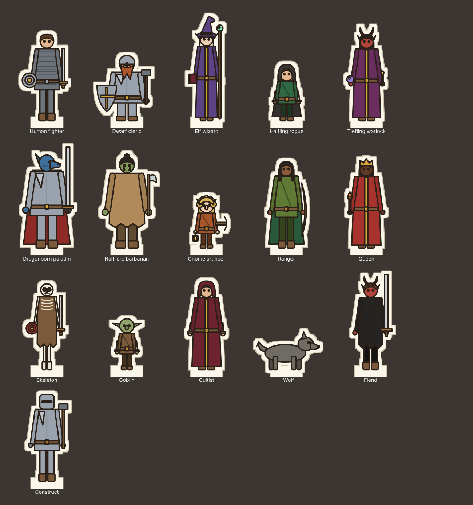

# Paper minis: style guide

Every character, NPC and monster on the table is a **paper mini**: a flat figure cut out of card,
standing in a little base, on the 3D map. Players make their own character's mini from their
private link; the DM makes the rest on the Minis page. One look for everyone.

This is the **paper** art style, the app's default. Its ink and card live in `src/shared/minis/paper/draw.ts`; the colours and proportions every style shares live in `src/shared/minis/style.ts`. Change them there, not in a part. Other styles can be added and swapped in (see *Art styles* below).

## The look in one line

Flat colour, one dark ink outline, cut out of cream card with a margin. No gradients, no
shading, no texture. It reads like a hand-made board-game piece, small, at a glance, on a dark
dungeon floor.

## Ink and paper

| | Value | Why |
|---|---|---|
| Ink | `#2b2118`, 2.6 units | A warm near-black, never pure black: softer next to KayKit's colours. Every shape gets it. |
| Paper | `#fbf6ea` | Cream card. 5 units of margin round the figure. |
| Paper edge | `#c9bea7` | A 1.5-unit darker rim, so the card reads as card on a light floor too. |
| Tab | 52 × 16 under the feet | What the base grips. |

## Colour

Use **palette names**, not hex, so a mini stays in the house colours: `crimson`, `navy`, `moss`,
`steel`, `skin-tan`, `hair-copper`, `scales-blue`… (the full list is `PALETTE`). Hex works when you
really need it.

- Cloth is muted and earthy. One strong colour per figure (the outfit or the cloak), not both.
- Metal is `steel`, `iron`, `bronze`, `gold`, `silver`. Gold is trim, not armour.
- Trim is the accent: belts, hems, shield bosses, robe stripes. Default `ochre`.
- Faces are simple: two ink dots for eyes. No mouths unless it's a creature feature (tusks, snout).

## Proportions

Card units: 120 wide, feet at y = 200. Heads are big (about a sixth of the height for humans,
bigger for small folk): they're what you recognise at token size.

| Ancestry | Height | Shoulders | Head radius | Notes |
|---|---|---|---|---|
| Human | 168 | 46 | 13 | The baseline. |
| Elf | 172 | 40 | 12.5 | Slim by default, pointed ears, longer legs. |
| Half-orc | 176 | 56 | 14 | Broad by default, tusks. |
| Tiefling | 168 | 44 | 13 | Horns, red skin by default. |
| Dragonborn | 182 | 54 | 15 | Snout, scales instead of hair. |
| Dwarf | 124 | 52 | 14 | Broad, short legs, long beard by default. |
| Halfling | 104 | 36 | 13 | |
| Gnome | 98 | 34 | 14 | The biggest head for the height. |
| Goblin | 100 | 34 | 14 | Big ears, grey-green. |
| Skeleton | 168 | 42 | 12 | Ribs and a skull; no hair or beard. |

Builds scale the shoulders: slim ×0.86, average ×1, broad ×1.18.

Card height follows the figure, so a gnome's card is shorter than an elf's on the table. Big
creatures (large, huge) get a bigger base and card, not a different style.

## Silhouette first

A mini has to read at 40 pixels. Before adding a part, check the silhouette:

1. **Headgear and weapons break the outline.** A wizard hat, a spear, horns: those are what you see
   from across the table. The card grows to fit them; nothing is cropped.
2. **One thing in each hand.** Weapon in the right (viewer's right), offhand in the left.
3. **Don't fill the card.** Keep gaps between the legs and between arms and body, so the cut-out
   has a shape.

## Monsters

A creature with no mini of its own gets one from its stat block (`miniForCreature`): its name
first (“Goblin Boss” → goblin, “Dire Wolf” → beast), then its type (undead → skeleton, fiend →
horned figure…). It's a placeholder in the house style; give important monsters their own on the Minis page.

Four-legged animals use the `beast` form: drawn side-on, the same ink and paper.

## Adding a part

1. Add the name to its list in `src/shared/minis/spec.ts` (e.g. `HEADGEAR`).
2. Draw it in the paper style (`src/shared/minis/paper/`) with the `shape` helpers only (they apply the ink), and in any other style.
3. If it reaches above the head, add it to `above()` so the card grows.
4. Look at it in the Minis page builder next to the others.
5. `npm test`: every ancestry draws every weapon without broken numbers.

## Art styles

A mini (`MiniSpec`) says *what* a figure is; an art style says how it's drawn. The same saved
minis, monsters and species then draw in whichever style the app uses.

- `src/shared/minis/styles.ts` has the `MiniArtStyle` interface, the list of styles
  (`ART_STYLES`) and the one in use (`DEFAULT_ART_STYLE`).
- A style is a folder like `paper/` exporting a `MiniArtStyle`: `render(mini)` returns an SVG in
  card units (feet at y = 200, a human about 168 tall), so cards of any style stand at the same
  height on the board.
- To add one: make the folder, add it to `ART_STYLES`, and run `npm test`: the tests draw every
  ancestry, part and creature form in every style. To swap, change `DEFAULT_ART_STYLE`.

